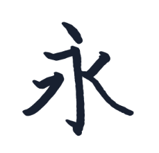
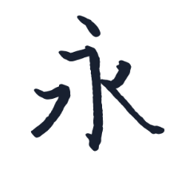

# InkBeautifier 笔迹美化

## 效果





InkBeautifier 将离散的鼠标、触控笔或触摸输入转换为平滑、动态宽度的笔迹。慢速书写时笔画更饱满，快速书写时自动收窄，并处理起笔、转向和收笔形态。

算法库使用纯 C#/.NET 实现，不依赖 Avalonia 或特定平台的绘图 API；示例使用 Avalonia 展示输入采集与轮廓填充。

## 项目结构

| 项目 | 用途 |
| --- | --- |
| `Code/InkBeautifierLib` | 平台无关的笔迹美化算法，接收输入点并输出闭合轮廓 |
| `Code/InkBeautifierAvaloniaDemo` | 可交互的 Avalonia 示例画板 |
| `Code/InkBeautifierAvaloniaTests` | 算法与真实 Skia 渲染回归测试 |

## 运行示例

需要安装 .NET 10 SDK。以下命令均在本 README 所在目录执行：

```shell
dotnet build InkBeautifier.slnx
dotnet run --project Code/InkBeautifierAvaloniaDemo/InkBeautifierAvaloniaDemo.csproj
```

打开画板后，可使用鼠标左键、触控笔或触摸书写：

- **笔宽**：调整低速书写时的最大宽度。
- **速度响应**：调整书写速度对宽度的影响。
- **清空**：清除画板及记录的输入数据。
- **导出问题笔迹**：将输入按顺序导出为 XML 格式的 TXT 文件，包含坐标、相对时间、压力和 `Down` / `Move` / `Up` 状态，便于精确回放与问题复现。

## 接入算法库

在调用项目中添加对 `Code/InkBeautifierLib/InkBeautifierLib.csproj` 的项目引用。当前算法库目标框架为 `net10.0`。

### 1. 创建美化器

```csharp
using InkBeautifierLib.Configuration;
using InkBeautifierLib.Geometry;
using InkBeautifierLib.Models;
using InkBeautifierLib.Processing;

var beautifier = new InkBeautifier(new InkBeautifierOptions
{
    MaximumWidth = 12,
    VelocityResponse = 2,
    PressureInfluence = 0
});
```

美化器会维护尚未完成的笔画状态，不要为每个输入点重新创建实例。请在同一线程上按输入顺序调用。

### 2. 按顺序传入采样点

```csharp
long strokeId = 1;

InkBeautifierResult down = beautifier.Process(new InkInputPoint(
    Position: new InkPoint2D(100, 100),
    Timestamp: 0,
    Pressure: 0.5,
    StrokeId: strokeId,
    Status: InkPointerStatus.Down));

InkBeautifierResult move = beautifier.Process(new InkInputPoint(
    Position: new InkPoint2D(120, 110),
    Timestamp: 16,
    Pressure: 0.5,
    StrokeId: strokeId,
    Status: InkPointerStatus.Move));

InkBeautifierResult up = beautifier.Process(new InkInputPoint(
    Position: new InkPoint2D(140, 115),
    Timestamp: 32,
    Pressure: 0.5,
    StrokeId: strokeId,
    Status: InkPointerStatus.Up));
```

输入约定：

- 同一笔的所有点使用相同 `StrokeId`；每笔以 `Down` 开始，以 `Up` 结束。
- `Timestamp` 单位为毫秒，同一笔使用一致的时间基准并保持时间递增，不要直接传入未经换算的计时器 tick。
- `Position` 使用一致的输入坐标系。坐标单位也会影响速度计算和距离阈值，因此不要在采样过程中改变缩放比例。
- `Pressure` 建议归一化到 `[0, 1]`；默认 `PressureInfluence = 0`，此时笔宽主要由速度控制。
- 即使最后位置未变化，也应传入 `Up`，以完成收笔并释放该笔的内部状态。

### 3. 填充输出轮廓

`Process` 返回当前笔画的完整结果，而不是新增的一小段：

| 属性 | 含义 |
| --- | --- |
| `StrokeId` | 结果所属笔画 |
| `Outlines` | 完整笔迹的多个独立闭合轮廓，渲染时应使用此属性 |
| `Outline` | 为兼容保留的单一主边界，不代表完整的渲染轮廓集合 |
| `WasAccepted` | 当前输入是否被采样规则接受 |
| `IsCompleted` | 当前笔画是否已经结束 |

渲染时按 `StrokeId` 保存最新的非空 `Outlines`，**替换该笔旧轮廓，不要把每次返回结果累加成新笔画**。每笔创建一个填充路径：

1. 对 `Outlines` 中每个轮廓分别开始一个子路径。
2. 按原顺序连接轮廓顶点，并闭合该子路径。
3. 使用 **NonZero（非零绕数）** 规则填充整条路径，不描边。

不要把多个轮廓首尾连接为一条折线，不要仅绘制 `Outline`，也不要改用 EvenOdd 填充规则，否则交叠区域可能出现错误空洞。

`Down` 返回空轮廓是正常行为；被过滤的输入可能返回上一次轮廓。不要仅根据 `WasAccepted` 判断笔画是否结束，应始终检查 `IsCompleted`，包括被过滤的 `Up`。

Avalonia 的完整接入示例见 [InkCanvas.cs](Code/InkBeautifierAvaloniaDemo/InkCanvas.cs)，其中使用同一个 `StreamGeometry` 的多个闭合 Figure 和 `FillRule.NonZero` 绘制每笔笔迹。

### 4. 清理状态

```csharp
beautifier.Reset();
```

`Reset()` 清除所有尚未完成的笔画状态；已保存的渲染轮廓由调用方管理，清空画布时也应同步清除这些轮廓。正常完成的笔画在收到 `Up` 后会自动移除内部状态。

## 参数配置

| 参数 | 默认值 | 说明 |
| --- | --- | --- |
| `MaximumWidth` | `12` | 最大笔宽，必须大于 0，单位与输入坐标一致 |
| `VelocityResponse` | `2` | 速度对宽度的衰减强度，值越大，提速时收窄越明显；必须非负 |
| `MinimumTimeInterval` | `7` | 移动采样的最小时间间隔，单位毫秒；必须非负 |
| `MinimumDistance` | `2` | 移动采样的最小距离，单位与输入坐标一致；必须非负 |
| `PressureInfluence` | `0` | 压力对宽度的影响程度，范围 `[0, 1]` |

所有参数必须是有限数值。选项为初始化属性，需要调整配置时创建新的选项与美化器，并避免在未完成的笔画中途切换。

建议在原始输入坐标系内计算笔迹，仅在绘制阶段统一变换轮廓。若调整算法输入坐标的尺度，应同时评估笔宽、距离阈值和速度响应，而不是只缩放点的位置。

## 测试与算法说明

运行回归测试：

```shell
dotnet test Code/InkBeautifierAvaloniaTests/InkBeautifierAvaloniaTests.csproj
```

测试覆盖采样、笔宽变化、端帽、交叠轮廓及真实 Skia 渲染。截图输出用于检查视觉效果，不应只依靠测试通过判断渲染质量。

算法细节见 [笔迹美化算法完全实现详解](Docs/笔迹美化算法完全实现详解.md)。
